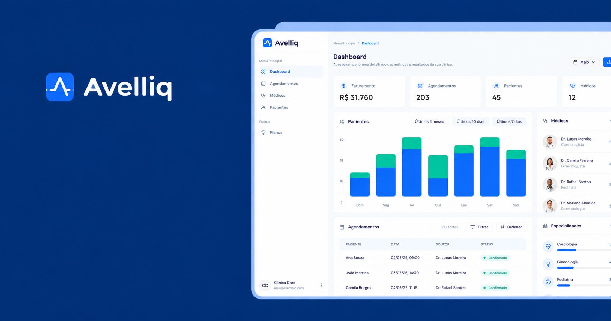

# 🩺 Avelliq



Sistema de agendamento para clínicas médicas: cadastro de médicos com dias e horários de atendimento, pacientes, consultas com horários livres calculados automaticamente, e um dashboard de faturamento. Toda conta começa no plano Free, e os planos pagos são cobrados via Stripe.

🔗 **Aplicação online:** [www.avelliq.com.br](https://www.avelliq.com.br)

> 💳 **Os planos pagos usam o modo de testes do Stripe.** Use o cartão `4242 4242 4242 4242`, com qualquer data de validade futura, CVC e CEP. **Não use dados reais de cartão.**

---

## ✨ Funcionalidades

- **Autenticação** com e-mail e senha ou conta Google ([Better Auth](https://www.better-auth.com)), com recuperação de senha por e-mail.
- **Clínica:** cada usuário trabalha dentro da sua clínica, e os dados de uma clínica não são visíveis para outra.
- **Médicos:** especialidade, valor da consulta, dias da semana e horário de atendimento.
- **Pacientes:** cadastro e listagem. Além dos dados básicos, a clínica pode registrar data de nascimento, CPF, endereço (preenchido pelo CEP), convênio, contato de emergência e observações administrativas.
- **Agendamentos:** só oferece horários dentro do expediente do médico e que ainda não estejam ocupados.
- **Dashboard:** faturamento, número de consultas, médicos e especialidades mais procurados, e os agendamentos do dia.
- **Marca da clínica (white label):** em Configurações da clínica, cada clínica envia o próprio logo (PNG, JPG ou WebP, reduzido para 128 px e guardado no banco) e escolhe a cor principal. O menu passa a mostrar a marca da clínica e os botões usam a cor dela, com o texto em branco ou preto conforme o contraste.
- **Tema claro e escuro:** segue o tema do sistema ou a escolha feita no menu do rodapé (Tema).
- **Planos** Free, Essencial e Profissional, com Stripe Checkout para assinar e o portal do cliente para trocar de plano ou cancelar.
- **LGPD:** Política de Privacidade e Termos de Uso com aceite registrado, exportação dos dados, exclusão da conta, registro de auditoria e limpeza automática de dados antigos. Detalhes e pendências em [`docs/lgpd`](docs/lgpd/README.md).

## 💼 Planos

| | Free | Essencial | Profissional |
|---|---|---|---|
| Cobrança | Grátis por 3 meses | Mensal ou anual | Mensal ou anual |
| Clínicas | 1 | 2 | Ilimitadas |
| Médicos (por clínica) | 1 | 5 | Ilimitados |
| Pacientes (por clínica) | 20 | 100 | Ilimitados |
| Agendamentos por mês (por clínica) | 40 | 200 | Ilimitados |

- **Limites:** os limites são verificados no servidor, ao cadastrar médicos, pacientes e agendamentos. Ficam em [`src/lib/plans.ts`](src/lib/plans.ts).
- **Visibilidade:** a página de assinatura mostra o uso de cada limite. Os botões de cadastro mostram o uso e, no limite, abrem um aviso explicando o motivo, com o caminho para o plano maior. Um aviso no topo das páginas informa cancelamento agendado, pagamento pendente e o fim do período gratuito.
- **Preços:** o valor exibido de cada plano pago vem do próprio Stripe, então é sempre o mesmo cobrado no checkout.
- **Plano anual:** opcional. Com os preços anuais configurados (`STRIPE_*_ANNUAL_PRICE_ID`), a página de assinatura ganha a escolha Mensal/Anual e mostra a economia em relação a 12 meses do mensal. Sem eles, só o mensal aparece.
- **No banco:** um usuário sem assinatura tem `plan` vazio e é tratado como Free.
- **Várias clínicas:** o seletor no rodapé do menu troca a clínica aberta; cada clínica tem seus próprios médicos, pacientes e agendamentos. Em **Minhas clínicas**, quem tem mais clínicas do que o plano permite (depois de um downgrade) escolhe quais continuam ativas; as outras ficam só leitura, sem perder dados. A primeira escolha é livre e, depois, vale uma alteração a cada 30 dias; para mais, o usuário fala com o suporte.
- **Fim do Free:** 3 meses depois da criação da clínica, a conta fica só leitura. Dá para ver os dados, mas cadastrar, editar e excluir exige um plano pago. Clínicas criadas antes dessa regra contam os 3 meses a partir de 15/10/2026. O prazo é controlado pelo app, não pelo Stripe.

## 🚀 Tecnologias

| Área | Ferramentas |
|---|---|
| Framework | Next.js 15 (App Router, Server Actions), React 19, TypeScript |
| Banco de dados | PostgreSQL, Drizzle ORM |
| Autenticação | Better Auth |
| Pagamentos | Stripe |
| Interface | Tailwind CSS, shadcn/ui (Radix UI), React Hook Form, Zod |
| Dados no cliente | next-safe-action, TanStack Query, nuqs |
| Datas | dayjs, date-fns |
| Testes | Vitest |
| Deploy | Vercel |

---

## 🧑‍💻 Rodando localmente

**Pré-requisitos:** Node.js 20+ e um banco PostgreSQL.

1. Instale as dependências:

   ```bash
   npm install
   ```

2. Crie um arquivo `.env` na raiz com as variáveis abaixo.

   | Variável | Para quê |
   |---|---|
   | `DATABASE_URL` | Conexão com o PostgreSQL |
   | `BETTER_AUTH_SECRET` | Chave usada para assinar as sessões (gere uma string aleatória longa) |
   | `BETTER_AUTH_URL` | URL base da aplicação, por exemplo `http://localhost:3000` |
   | `NEXT_PUBLIC_APP_URL` | URL pública da aplicação, usada nos redirecionamentos do Stripe |
   | `GOOGLE_CLIENT_ID`, `GOOGLE_CLIENT_SECRET` | Login com Google |
   | `STRIPE_SECRET_KEY` | Chave secreta do Stripe (modo de testes). O checkout abre na página hospedada pelo Stripe, sem Stripe.js no app, então a chave pública não é usada |
   | `STRIPE_ESSENTIAL_PLAN_PRICE_ID` | ID do preço mensal do plano Essencial no Stripe |
   | `STRIPE_PROFESSIONAL_PLAN_PRICE_ID` | ID do preço mensal do plano Profissional no Stripe |
   | `STRIPE_ESSENTIAL_ANNUAL_PRICE_ID`, `STRIPE_PROFESSIONAL_ANNUAL_PRICE_ID` | IDs dos preços anuais (opcionais). Com eles, a página de assinatura mostra a opção Mensal/Anual com a economia calculada. Libere também os preços anuais em **Stripe → Customer portal → Products**, senão quem assina não consegue trocar de plano pelo portal |
   | `STRIPE_WEBHOOK_SECRET` | Segredo do webhook (veja a seção do Stripe abaixo) |
   | `NEXT_PUBLIC_STRIPE_CUSTOMER_PORTAL_URL` | Link do portal do cliente do Stripe. No Stripe, configure o link de retorno do portal para `/assinatura` |
   | `SUPPORT_EMAIL` | E-mail de suporte e canal de privacidade, mostrado na Política de Privacidade, nos Termos e a quem precisa alterar as clínicas ativas antes dos 30 dias. Use um e-mail do domínio, não um pessoal |
   | `LEGAL_CNPJ` | CNPJ mostrado na Política de Privacidade e nos Termos (opcional). Fica fora do código porque o repositório é público |
   | `RESEND_API_KEY`, `EMAIL_FROM` | Envio de emails pelo [Resend](https://resend.com). Com as duas definidas, a conta só é liberada depois de confirmar o email e o "Esqueci minha senha" fica disponível (opcional) |
   | `CRON_SECRET` | Segredo da limpeza diária (Vercel Cron) de sessões expiradas e registros de auditoria com mais de 5 anos. Sem ele, a limpeza não roda |

3. Crie as tabelas no banco a partir do schema:

   ```bash
   npx drizzle-kit push
   ```

   Use `push`, não `migrate`: as primeiras migrações da pasta `drizzle/` são da versão original do projeto e não rodam em sequência num banco vazio.

4. Inicie o servidor de desenvolvimento e abra [http://localhost:3000](http://localhost:3000):

   ```bash
   npm run dev
   ```

### Scripts

| Comando | O que faz |
|---|---|
| `npm run dev` | Servidor de desenvolvimento |
| `npm run build` | Build de produção. Na Vercel (produção), antes confere se o banco tem todas as colunas e índices do schema |
| `npm start` | Sobe o build de produção |
| `npm run lint` | ESLint |
| `npm test` | Testes com Vitest |
| `npm run test:integration` | Testes contra um PostgreSQL real (defina `INTEGRATION_DATABASE_URL` com um banco de teste) |
| `npx drizzle-kit studio` | Interface visual do banco |

### Stripe em ambiente local

Para receber os eventos de pagamento na sua máquina, use a [Stripe CLI](https://docs.stripe.com/stripe-cli):

```bash
stripe login
stripe listen --forward-to localhost:3000/api/stripe/webhook
```

O comando `stripe listen` mostra um segredo `whsec_...`. Coloque esse valor em `STRIPE_WEBHOOK_SECRET` no `.env`.

---

## 🧭 Rotas

As páginas usam endereços em português: `/painel`, `/agendamentos`, `/medicos`, `/pacientes`, `/assinatura`, `/clinicas`, `/configuracoes-da-clinica`, `/nova-clinica`, `/minha-conta`, `/entrar`, `/esqueci-senha` e `/redefinir-senha`. Os endereços antigos em inglês redirecionam permanentemente para os novos (veja `next.config.ts`). As rotas de API continuam em `/api/...`.

---

## 🗄️ Banco de produção

O banco de produção foi criado com `drizzle-kit push` e não tem o histórico do `drizzle-kit migrate`. Cada mudança de schema gera um arquivo novo em `drizzle/` (`npx drizzle-kit generate --name <nome>`), que é aplicado à mão, **antes do merge** do código que depende dele:

```bash
psql "$DATABASE_URL" -P pager=off -f drizzle/000X_nome.sql
```

Se a migração for esquecida, o deploy não chega a ir ao ar: no build de produção da Vercel, [`scripts/check-db-schema.mjs`](scripts/check-db-schema.mjs) compara as colunas e os índices do schema com os do banco e falha o build listando o que falta, e a versão anterior continua no ar. Para rodar a mesma verificação localmente: `CHECK_DB_SCHEMA=1 npm run build`.

Não cole a `DATABASE_URL` em chats, issues ou commits.

---

## 🕒 Fuso horário

A clínica opera no fuso `America/Sao_Paulo`, mas o servidor pode estar em qualquer fuso (na Vercel, é UTC). Por isso:

- O horário de atendimento dos médicos e a data das consultas são **gravados em UTC**.
- Tudo o que é exibido ou escolhido na interface está **no horário da clínica**.
- As conversões ficam todas em [`src/helpers/time.ts`](src/helpers/time.ts). Use essas funções em vez de converter datas diretamente com `dayjs()` ou `new Date()`, que dependem do fuso de quem executa o código.

---

## 📋 Próximos passos

- [ ] Autenticação em dois fatores
- [ ] Campo `status` nos agendamentos
- [ ] Manter o histórico de agendamentos ao excluir um médico (hoje são apagados junto)
- [ ] Content Security Policy para scripts, com nonce por requisição
